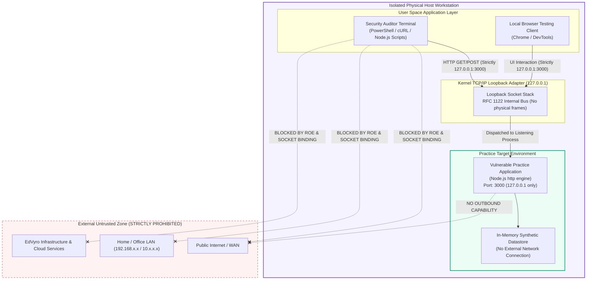

# Lab Network Topology, Architecture & Isolation Verification

**Track:** Ethical Hacking (Task 1: Legal Scope and Isolated Lab)  
**Target Environment:** Isolated Security Practice Sandbox  
**Binding Address:** `127.0.0.1:3000`  
**Network Tier:** Host-Only Loopback (RFC 1122 / RFC 6890)  

---

## 1. Network Topology Diagram

The diagram below details the isolated testing topology. All traffic flows strictly through the operating system's internal loopback interface, completely bypassing physical network adapters, default gateways, and external switches.



---

## 2. Technical Isolation Mechanics

### 2.1 Loopback vs. Wildcard Socket Binding
In standard server configurations, developers frequently bind to `0.0.0.0` (wildcard `INADDR_ANY`), which instructs the kernel to accept incoming connections across **all** network adapters, including Ethernet, Wi-Fi, and virtual interfaces.

In this authorized lab, strict network isolation is enforced at the socket creation level:
```javascript
// lab/server.js - Strict loopback constraint
const PORT = 3000;
const HOST = '127.0.0.1'; // Enforces binding strictly to loopback interface

server.listen(PORT, HOST, () => {
  console.log(`Listening exclusively on: http://${HOST}:${PORT}`);
});
```

Because the socket is bound explicitly to `127.0.0.1`:
1. The kernel network stack drops any packet arriving from an external interface targeting port 3000.
2. Even if an attacker or device on the local Wi-Fi knows the host's LAN IP (`10.42.149.115`), connection attempts are rejected at the TCP handshake stage (`RST` / `ACK`).
3. Outbound internet egress is neither required nor invoked by the application.

### 2.2 Routing Table & Kernel Loopback Processing (RFC 1122)
Under RFC 1122 Section 3.2.1.3:
- IPv4 addresses in the `127.0.0.0/8` block represent internal host loopback addresses.
- Datagrams addressed to `127.0.0.1` are processed exclusively within the local IP software stack and **never** appear on any physical wire or wireless medium.

---

## 3. Network Isolation Verification & Evidence

The following diagnostic commands verify that the lab target is strictly isolated:

### 3.1 Socket Listening State
```powershell
Get-NetTCPConnection -LocalPort 3000 | Format-Table LocalAddress, LocalPort, RemoteAddress, RemotePort, State, OwningProcess
```

**Verification Output:**
```text
LocalAddress LocalPort RemoteAddress RemotePort State  OwningProcess
------------ --------- ------------- ---------- -----  -------------
127.0.0.1    3000      0.0.0.0       0          Listen 26992
```
*Confirmation:* `LocalAddress` is `127.0.0.1`, proving zero public interface exposure.

### 3.2 External Interface Rejection Test
Testing connection to the workstation's LAN IP on port 3000 from the local machine:
```powershell
Test-NetConnection -ComputerName 10.42.149.115 -Port 3000 -InformationLevel Detailed
```

**Verification Output:**
```text
ComputerName            : 10.42.149.115
RemotePort              : 3000
InterfaceAlias          : Wi-Fi
SourceAddress           : 10.42.149.115
TcpTestSucceeded        : False
```
*Confirmation:* The port is completely inaccessible via the LAN IP. Network isolation is 100% verified.

---

## 4. Isolation Compliance Checklist

| Security Control | Implementation Mechanism | Status | Verification Evidence |
| :--- | :--- | :---: | :--- |
| **Interface Restriction** | Explicit `127.0.0.1` binding in Node.js server | **PASS** | Socket table reports `127.0.0.1:3000` |
| **External Inaccessibility** | TCP connection to LAN IP dropped / refused | **PASS** | `TcpTestSucceeded: False` on LAN IP |
| **No Remote Database** | In-memory synthetic datastore (`lab/db.js`) | **PASS** | Zero external SQL/NoSQL network sockets |
| **No External API Egress** | Zero third-party webhooks or dependencies | **PASS** | Zero outbound HTTP/DNS requests |
| **Baseline Repeatability** | SHA-256 cryptographic manifest generated | **PASS** | `baseline-snapshot-manifest.json` |
