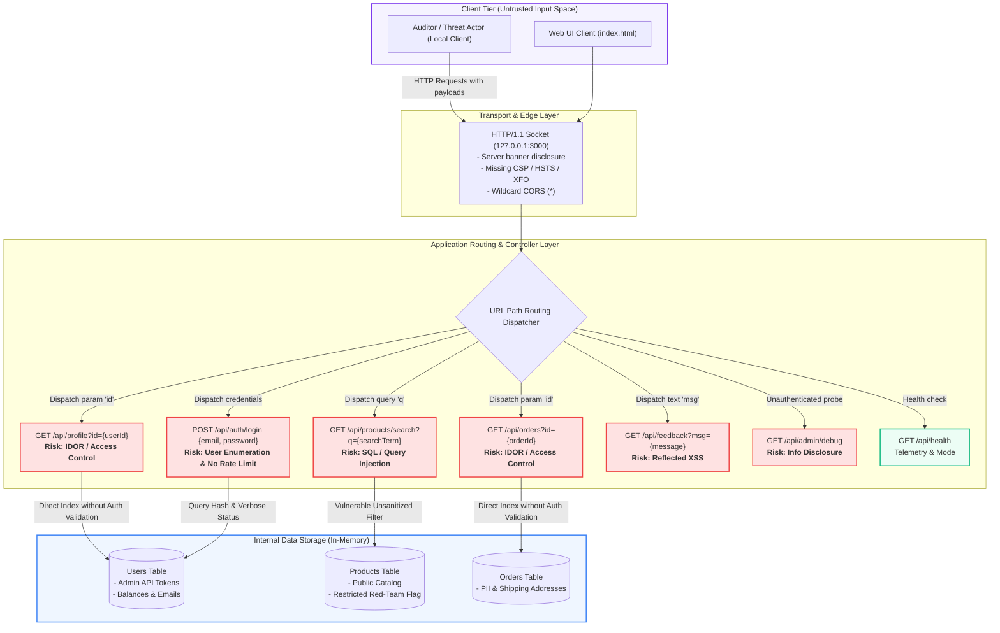

# Visual Attack Surface Map & Architecture Diagram

**Track:** Ethical Hacking (Task 2: Local Reconnaissance and Attack Surface Map)  
**Target:** `http://127.0.0.1:3000`  
**Scope:** Complete End-to-End Application Data Flow & Attack Boundaries  

---

## 1. Attack Surface Architecture Flowchart

The diagram below maps all identified entry points, exposed parameters, middleware processing steps, and sensitive backend data stores:

---

## 2. Attack Surface Breakdown by Layer

### Layer 1: Network & Transport Surface
- **Exposed Surface:** Port `3000/TCP` bound to `127.0.0.1`.
- **Protocol:** HTTP/1.1 without TLS encapsulation.
- **Header Surface:**
  - Leaked server runtime headers (`Server`, `X-Powered-By`).
  - Missing browser protection policies (no CSP, no frame protection, no MIME sniff blocking).

### Layer 2: API & Controller Surface
- **Public Unauthenticated APIs:**
  - `/api/products/search`: String parameter `q` is directly evaluated in datastore query filters.
  - `/api/profile`: Numeric parameter `id` looks up user profiles without token checks.
  - `/api/orders`: Numeric parameter `id` looks up order details without ownership checks.
  - `/api/auth/login`: Accepts JSON body `{email, password}` with verbose differentiation between invalid email and invalid password.
  - `/api/feedback`: Reflects parameter `msg` as raw HTML.
  - `/api/admin/debug`: Directly dumps server environment variables and internal route maps.

### Layer 3: Persistence & Data Storage Surface
- **Database Tables:** `users`, `products`, `orders`.
- **Sensitive Assets Stored:**
  - Administrator session tokens (`apiToken`).
  - User financial balances and personal contact details (phone, full name).
  - Unreleased/restricted red-team assessment packages and internal flags.
  - Order histories with residential shipping addresses.
