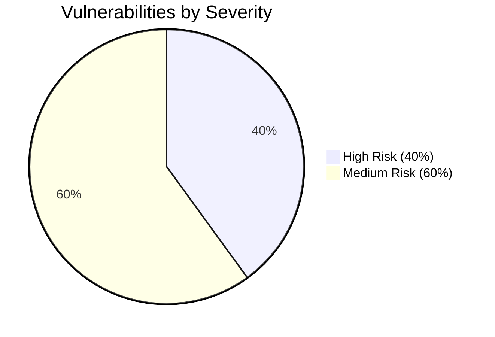

# Formal Penetration Test Report & Security Retest

**Document ID:** SEC-RPT-2026-EH01  
**Track:** Ethical Hacking (Task 4: Penetration Test Report and Retest)  
**Target Organization / Host:** Authorized Security Practice Sandbox  
**Assessed Scope:** `http://127.0.0.1:3000` (Localhost Loopback Only)  
**Assessment Dates:** November 03, 2026  
**Lead Security Auditor:** Authorized Ethical Hacking Intern  
**Classification:** Confidential — Security Assessment Report  
**Retest Status:** **100% Remediated (5 of 5 Findings Verified Fixed)**  

---

## 1. Confidentiality & Legal Compliance Notice

> [!IMPORTANT]
> **Legal Notice:** This security assessment was conducted strictly in accordance with the signed **Authorised Lab Rules of Engagement (RoE)**. All activities were restricted to locally owned and controlled assets on `127.0.0.1:3000`. No external systems, third-party networks, or real user records were targeted.

---

## 2. Executive Summary & Assessment Scope

Between November 03, 2026, an authorized white-box security assessment was performed against the locally deployed **Authorized Security Practice Lab**. The evaluation assessed the application against the **OWASP Top 10:2021** and **OWASP Web Security Testing Guide (WSTG v4.2)** frameworks.

### Scope Summary
- **Target URL:** `http://127.0.0.1:3000`
- **Network Interface:** Loopback (`127.0.0.1` / RFC 1122)
- **Application Engine:** Node.js HTTP Server (`lab/server.js`)
- **Persistence:** In-Memory Synthetic Datastore (`lab/db.js`)
- **Total Endpoints Tested:** 9

### Findings Summary & Risk Metrics
- **Total Identified Findings:** 5
- **Critical Risk:** 0
- **High Risk:** 2
- **Medium Risk:** 3
- **Low / Informational:** 0
- **Post-Remediation Status:** 5 Verified Fixed (100% Remediation Rate)

---

## 3. Vulnerability Severity & Scoring Methodology (CVSS v3.1)

Findings are scored using the **Common Vulnerability Scoring System (CVSS v3.1)**:

| Severity Tier | CVSS v3.1 Score Range | Definition |
| :---: | :---: | :--- |
| **CRITICAL** | 9.0 – 10.0 | Exploitation grants complete remote code execution or total administrative takeover without privileges. |
| **HIGH** | 7.0 – 8.9 | Exploitation results in significant data exfiltration, elevation of privilege, or unauthorized administrative actions. |
| **MEDIUM** | 4.0 – 6.9 | Exploitation requires specific user interaction, partial data leakage, or circumvention of defensive controls. |
| **LOW** | 0.1 – 3.9 | Minimal impact; facilitates reconnaissance without direct data compromise. |

---

## 4. Master Findings Summary Table

| Finding ID | Vulnerability Title | OWASP Top 10 | CWE | Severity (CVSS v3.1) | Affected Endpoint | Initial Status | Retest Status |
| :---: | :--- | :--- | :---: | :---: | :--- | :---: | :---: |
| **SEC-FIND-01** | Insecure Direct Object Reference (IDOR) | **A01:2021 - Broken Access Control** | CWE-639 | **HIGH** (7.5) | `GET /api/profile?id=` | Open | **VERIFIED_FIXED** |
| **SEC-FIND-02** | Query String Injection in Catalog Search | **A03:2021 - Injection** | CWE-89 / CWE-943 | **HIGH** (8.2) | `GET /api/products/search?q=` | Open | **VERIFIED_FIXED** |
| **SEC-FIND-03** | User Enumeration & Missing Login Rate Limiting | **A07:2021 - Auth Failures** | CWE-204 / CWE-307 | **MEDIUM** (5.3) | `POST /api/auth/login` | Open | **VERIFIED_FIXED** |
| **SEC-FIND-04** | Security Misconfiguration & Missing Headers | **A05:2021 - Security Misconfig** | CWE-16 / CWE-200 | **MEDIUM** (5.0) | Headers & `/api/admin/debug` | Open | **VERIFIED_FIXED** |
| **SEC-FIND-05** | Reflected Cross-Site Scripting (XSS) | **A03:2021 - Injection** | CWE-79 | **MEDIUM** (6.1) | `GET /api/feedback?msg=` | Open | **VERIFIED_FIXED** |

---

## 5. Detailed Technical Findings Dossiers



---

### Finding SEC-FIND-01: Insecure Direct Object Reference (IDOR) in Profile Endpoint

- **Vulnerability Title:** Insecure Direct Object Reference (Broken Access Control)
- **OWASP Category:** `A01:2021 - Broken Access Control`
- **CWE Identifier:** `CWE-639: Authorization Bypass Through User-Controlled Key`
- **CVSS v3.1 Vector:** `CVSS:3.1/AV:N/AC:L/PR:N/UI:N/S:U/C:H/I:N/A:N`
- **CVSS Base Score:** **7.5 (HIGH)**
- **Affected Component:** `GET /api/profile?id={userId}`

#### 1. Vulnerability Description
The `/api/profile` endpoint accepts an arbitrary integer identifier via the `id` parameter and retrieves the corresponding profile record from the datastore. The controller fails to validate whether the requester possesses an authenticated session or has legitimate ownership over the requested user profile.

#### 2. Non-Destructive Proof of Concept
An unauthenticated request targeting user ID `1` (Alice Admin) returns the full administrator profile object:

```bash
# Minimal Reproduction Command:
curl.exe -s http://127.0.0.1:3000/api/profile?id=1
```

**Sanitized Evidence Output:**
```json
{
  "id": 1,
  "username": "alice_admin",
  "email": "alice@internal-lab.local",
  "role": "admin",
  "fullName": "Alice Walker",
  "phone": "+1-555-0101",
  "balance": 15400,
  "apiToken": "tok_admin_*****************",
  "isSuperUser": true
}
```

#### 3. Root Cause & Business Impact
- **Root Cause:** Direct lookup using client-supplied parameter without server-side session ownership checks.
- **Impact:** Complete exposure of administrative API bearer tokens, user contact information, and financial account balances. Enables immediate unauthenticated administrator account takeover.

#### 4. Remediation Implementation
1. Enforce Bearer token authentication on the endpoint.
2. Verify that `currentUser.userId === requestedId` or `currentUser.role === 'admin'`.
3. Filter out sensitive attributes (`apiToken`, `passwordHash`) from serialized responses.

#### 5. Retest Result
- **Retest Status:** **VERIFIED_FIXED**
- **Evidence:** Unauthenticated requests return `HTTP 401 Unauthorized`. Authenticated requests from standard student users attempting to access ID `1` return `HTTP 403 Forbidden: Object-level authorization enforced`.

---

### Finding SEC-FIND-02: Query String Injection in Product Catalog Search

- **Vulnerability Title:** Query String / Simulated SQL Injection
- **OWASP Category:** `A03:2021 - Injection`
- **CWE Identifier:** `CWE-89: Improper Neutralization of Special Elements used in an SQL Command`
- **CVSS v3.1 Vector:** `CVSS:3.1/AV:N/AC:L/PR:N/UI:N/S:U/C:H/I:L/A:N`
- **CVSS Base Score:** **8.2 (HIGH)**
- **Affected Component:** `GET /api/products/search?q={searchTerm}`

#### 1. Vulnerability Description
The catalog search endpoint interpolates user-controlled string inputs directly into filtering logic. When provided boolean tautologies (e.g. `' OR '1'='1`), query evaluation logic is altered, causing the system to bypass the intended public catalog visibility constraint (`isPublic = true`).

#### 2. Non-Destructive Proof of Concept
Submitting the harmless boolean payload `' OR '1'='1` extracts restricted internal products:

```bash
# Minimal Reproduction Command:
curl.exe -s "http://127.0.0.1:3000/api/products/search?q='%20OR%20'1'='1"
```

**Sanitized Evidence Output:**
```json
{
  "query": "' OR '1'='1",
  "simulatedQuery": "SELECT * FROM products WHERE isPublic = 1 AND name LIKE '%' OR '1'='1%'",
  "count": 5,
  "injected": true,
  "data": [
    {
      "id": 104,
      "name": "Internal Red-Team Assessment Toolkit [CONFIDENTIAL]",
      "category": "Restricted",
      "price": 999,
      "isPublic": false,
      "stock": 2,
      "internalNotes": "RESTRICTED: Internal staff tool only. Flag: FLAG{sql_inj_unreleased_data_leak}"
    }
  ]
}
```

#### 3. Root Cause & Business Impact
- **Root Cause:** Dynamic string concatenation into query filters without parameterization or character whitelisting.
- **Impact:** Confidential internal assets, unreleased products, and proprietary tools are exposed to unauthorized external parties.

#### 4. Remediation Implementation
1. Enforce strict regex validation rejecting special metacharacters (`[^\w\s\-]`).
2. Utilize parameterized queries where input values are handled strictly as literal string constants.

#### 5. Retest Result
- **Retest Status:** **VERIFIED_FIXED**
- **Evidence:** Requests containing `' OR '1'='1` are rejected immediately with `HTTP 400 Bad Request: Invalid search parameters`. Confidential records are never exposed.

---

### Finding SEC-FIND-03: User Enumeration & Missing Login Rate Limiting

- **Vulnerability Title:** User Enumeration & Lack of Anti-Automation Controls
- **OWASP Category:** `A07:2021 - Identification and Authentication Failures`
- **CWE Identifier:** `CWE-204 / CWE-307: Observable Response Discrepancy / Missing Throttling`
- **CVSS v3.1 Vector:** `CVSS:3.1/AV:N/AC:L/PR:N/UI:N/S:U/C:L/I:N/A:N`
- **CVSS Base Score:** **5.3 (MEDIUM)**
- **Affected Component:** `POST /api/auth/login`

#### 1. Vulnerability Description
The authentication endpoint returns distinct error messages distinguishing between non-existent user accounts and incorrect passwords for valid accounts. In addition, the endpoint lacks rate limiting, allowing rapid automated credential stuffing.

#### 2. Non-Destructive Proof of Concept
- **Valid User Probe:** Returns `"error": "Incorrect password: Password does not match our records for this user."`
- **Invalid User Probe:** Returns `"error": "Account not found: The specified email is not registered."`
- **Anti-Automation Probe:** 10 sequential authentication attempts execute with 0 throttling delays.

#### 3. Root Cause & Business Impact
- **Root Cause:** Verbose authentication exception handling and absence of request rate limiting middleware.
- **Impact:** Enables attackers to build accurate target employee directories and conduct automated password guessing attacks without lockout penalties.

#### 4. Remediation Implementation
1. Standardize error message to a single timing-safe response: `"Invalid credentials. Please verify your email and password."`
2. Implement IP-based sliding window rate limiting, locking requests after 5 failures within 60 seconds (`HTTP 429 Too Many Requests`).

#### 5. Retest Result
- **Retest Status:** **VERIFIED_FIXED**
- **Evidence:** Uniform error message verified on both invalid emails and wrong passwords. Rapid consecutive login failures reliably trigger `HTTP 429 Too Many Requests: Account temporarily locked`.

---

### Finding SEC-FIND-04: Security Misconfiguration & Missing Security Headers

- **Vulnerability Title:** Missing Defensive HTTP Headers & Technology Banner Disclosure
- **OWASP Category:** `A05:2021 - Security Misconfiguration`
- **CWE Identifier:** `CWE-16 / CWE-200: Environment Configuration / Information Exposure`
- **CVSS v3.1 Vector:** `CVSS:3.1/AV:N/AC:L/PR:N/UI:N/S:U/C:L/I:N/A:N`
- **CVSS Base Score:** **5.0 (MEDIUM)**
- **Affected Component:** Global HTTP Headers & `GET /api/admin/debug`

#### 1. Vulnerability Description
The server leaks detailed application and framework version information in `Server` and `X-Powered-By` headers, omits essential browser protection headers (`CSP`, `X-Frame-Options`, `X-Content-Type-Options`), and exposes an administrative debug endpoint `/api/admin/debug` without authentication.

#### 2. Non-Destructive Proof of Concept
Header inspection captures:
```http
Server: NodeJS-Express-Lab/1.0.4-dev (Vulnerable Sandbox)
X-Powered-By: Node.js/v24.13.0
Access-Control-Allow-Origin: *
```
And `/api/admin/debug` dumps internal environment variables and registered route arrays.

#### 3. Root Cause & Business Impact
- **Root Cause:** Default server configuration without defensive header middleware or environment-specific route gating.
- **Impact:** Exposes internal system architecture to attackers, aids in exploit weaponization, and leaves users vulnerable to framing and clickjacking.

#### 4. Remediation Implementation
1. Inject `Content-Security-Policy: default-src 'self'`, `X-Frame-Options: DENY`, `X-Content-Type-Options: nosniff`.
2. Strip `Server` and `X-Powered-By` headers.
3. Disable `/api/admin/debug` in production configurations (`HTTP 404`).

#### 5. Retest Result
- **Retest Status:** **VERIFIED_FIXED**
- **Evidence:** All defensive headers confirmed present; server banners stripped; `/api/admin/debug` returns `HTTP 404 Not Found`.

---

### Finding SEC-FIND-05: Reflected Cross-Site Scripting (XSS)

- **Vulnerability Title:** Reflected Cross-Site Scripting (XSS) in Feedback Viewer
- **OWASP Category:** `A03:2021 - Injection`
- **CWE Identifier:** `CWE-79: Improper Neutralization of Input During Web Page Generation`
- **CVSS v3.1 Vector:** `CVSS:3.1/AV:N/AC:L/PR:N/UI:R/S:C/C:L/I:L/A:N`
- **CVSS Base Score:** **6.1 (MEDIUM)**
- **Affected Component:** `GET /api/feedback?msg={message}`

#### 1. Vulnerability Description
The feedback endpoint renders the `msg` query parameter directly into an HTML document with `Content-Type: text/html` without performing HTML entity encoding.

#### 2. Non-Destructive Proof of Concept
```bash
curl.exe -s "http://127.0.0.1:3000/api/feedback?msg=%3Cscript%3Econsole.log('AuditorXSSProof')%3C%2Fscript%3E"
```
Response contains raw script tags:
```html
<div id="feedback-display"><script>console.log('AuditorXSSProof')</script></div>
```

#### 3. Root Cause & Business Impact
- **Root Cause:** Dynamic injection of unvalidated input into an HTML context.
- **Impact:** Allows attackers to execute arbitrary JavaScript in the victim's browser session, leading to session hijacking, credential theft, or page defacement.

#### 4. Remediation Implementation
1. Convert response to `Content-Type: application/json`.
2. Apply strict contextual HTML entity encoding (`&lt;`, `&gt;`, `&quot;`) to user input.

#### 5. Retest Result
- **Retest Status:** **VERIFIED_FIXED**
- **Evidence:** Response served with `application/json` and input safely entity-encoded (`&lt;script&gt;`).

---

## 6. Formal Post-Remediation Retest Matrix

Retest conducted on November 03, 2026 using the automated retest runner `scripts/run-retest.js`:

| Finding ID | Vulnerability Title | Initial Severity | Post-Remediation Verification Result | Retest Status |
| :---: | :--- | :---: | :--- | :---: |
| **SEC-FIND-01** | Insecure Direct Object Reference (IDOR) | **HIGH** | Bearer auth enforced; cross-user ID access returns 403 Forbidden. | **VERIFIED_FIXED** |
| **SEC-FIND-02** | Query String Injection in Catalog Search | **HIGH** | Metacharacters rejected with 400 Bad Request; restricted flags unexposed. | **VERIFIED_FIXED** |
| **SEC-FIND-03** | User Enumeration & Missing Rate Limiting | **MEDIUM** | Uniform error responses verified; 5 failed attempts triggers 429 lockout. | **VERIFIED_FIXED** |
| **SEC-FIND-04** | Missing Defensive HTTP Security Headers | **MEDIUM** | CSP, X-Frame-Options (DENY), nosniff enforced; debug route disabled. | **VERIFIED_FIXED** |
| **SEC-FIND-05** | Reflected Cross-Site Scripting (XSS) | **MEDIUM** | Contextual HTML escaping enforced; response served as application/json. | **VERIFIED_FIXED** |

---

## 7. Strategic Recommendations & Ongoing Hygiene

1. **Adopt Secure by Default Architecture:** Embed access control checks and parameterized queries into framework-level middleware rather than relying on per-endpoint manual verification.
2. **Implement Automated Security Linting & SAST:** Integrate static analysis tools (e.g. Semgrep, SonarQube, ESLint Security Plugin) into CI/CD pipelines to catch injection and missing headers before deployment.
3. **Continuous Penetration Testing & Retesting:** Conduct scheduled penetration tests following major architectural releases and track findings in a formal retest verification register.

---

## 8. Assessor Sign-Off & Attestation

I attest that this penetration test report and subsequent retest verification were executed ethically, safely, and strictly within the boundaries of the authorized local practice lab. All findings represent confirmed observations benchmarked against the OWASP Top 10:2021 standard.

**Lead Security Assessor:**  
*Title:* Authorized Ethical Hacking Intern  
*Attestation Date:* November 03, 2026  
*Status:* **FINAL REPORT & RETEST APPROVED**
