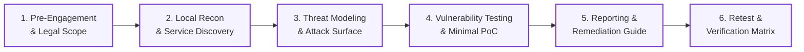

# Technical Testing Methodology & Penetration Testing Framework

**Track:** Ethical Hacking (Task 4: Penetration Test Report and Retest)  
**Standard:** Penetration Testing Execution Standard (PTES) & OWASP Web Security Testing Guide (WSTG v4.2)  
**Target:** `http://127.0.0.1:3000`  
**Execution Type:** White-Box Web Application Penetration Test  

---

## 1. Methodology Overview

The penetration test was conducted following industry-standard execution standards, integrating the procedural rigour of the **Penetration Testing Execution Standard (PTES)** with the web-specific vulnerability assessment criteria of the **OWASP Web Security Testing Guide (WSTG v4.2)**.

---

## 2. Structured Execution Phases

### Phase 1: Pre-Engagement & Scope Verification
- **RoE Establishment:** Formulated the legally binding Rules of Engagement (RoE) prohibiting testing on third-party networks.
- **Boundary Verification:** Validated that the target socket binds strictly to `127.0.0.1:3000` via loopback routing checks.
- **Repeatable Baseline:** Established cryptographic SHA-256 baseline snapshot manifests for all application source files.

### Phase 2: Local Reconnaissance & Intelligence Gathering (WSTG-INFO)
- **Passive Enumeration:** Captured HTTP banners, server headers, and cookie handling attributes via `curl` and PowerShell.
- **Route Mapping:** Discovered active and administrative REST routes (`/api/health`, `/api/version`, `/api/products/search`, `/api/profile`, `/api/orders`, `/api/auth/login`, `/api/feedback`, `/api/admin/debug`).
- **Input Surface Discovery:** Identified URL parameters (`q`, `id`, `msg`) and JSON request payload bodies.

### Phase 3: Threat Modeling & Attack Surface Formulation
- **Data Flow Analysis:** Mapped client requests through HTTP transport, routing middleware, authentication controllers, and the in-memory persistence layer.
- **Hypothesis Formulation:** Generated 8 risk hypotheses mapping empirical observations to potential OWASP vulnerability categories.
- **Threat Prioritization:** Ranked testing targets using the OWASP Risk Rating formula ($\text{Likelihood} \times \text{Impact}$).

### Phase 4: Vulnerability Analysis & Non-Destructive Proof of Concept (WSTG-ATHZ, WSTG-INPV, WSTG-CONF)
- **Broken Access Control (WSTG-ATHZ-02):** Evaluated object-level authorization across `/api/profile?id=` and `/api/orders?id=` using distinct simulated user IDs.
- **Input Injection Testing (WSTG-INPV-05 / WSTG-INPV-01):** Evaluated product catalog search parameters using SQL/query tautologies (`' OR '1'='1`) and feedback endpoints for script tag reflection.
- **Authentication & Rate Limiting (WSTG-ATHN-02 / WSTG-ATHN-07):** Evaluated login response differentiations and verified the absence of IP throttling under sequential failed authentication requests.
- **Defensive Configuration Auditing (WSTG-CONF-07):** Audited HTTP response headers for missing browser security controls (`CSP`, `X-Frame-Options`, `X-Content-Type-Options`).

### Phase 5: Reporting & Remediation Design
- **Safe Evidence Capture:** Formulated minimal, sanitized Proof-of-Concept documents redacting live session credentials.
- **Root Cause & Impact:** Evaluated business, legal, and regulatory consequences (GDPR / DPDP compliance).
- **Remediation Blueprints:** Provided actionable code diffs and configuration templates.

### Phase 6: Post-Remediation Retest & Verification
- **Automated Retest Suite:** Developed `scripts/run-retest.js` to systematically re-evaluate all 5 identified vulnerabilities against the secured application instance (`--secure`).
- **Verification Matrix:** Recorded exact post-fix status (`FIXED`, `MITIGATED`, or `UNRESOLVED`) with comparative technical proof.

---

## 3. Tooling & Execution Environment

| Tool / Technology | Version | Purpose in Assessment |
| :--- | :---: | :--- |
| **Node.js Runtime** | `v24.13.0` | Target server execution and automated testing runner |
| **PowerShell Core** | `5.1 / 7+` | Socket inspection, firewall auditing, network verification |
| **cURL CLI** | `8.x` | Raw HTTP header inspection, verb tampering, payload delivery |
| **Custom Test Suites** | `1.0.0` | `scripts/run-recon.js`, `test-owasp-findings.js`, `run-retest.js` |
| **Windows NetTCP** | Native OS | Port binding, state, and process ownership verification |

All tooling operated strictly at low request rates (<10 req/sec) to maintain host stability and prevent denial-of-service conditions.
